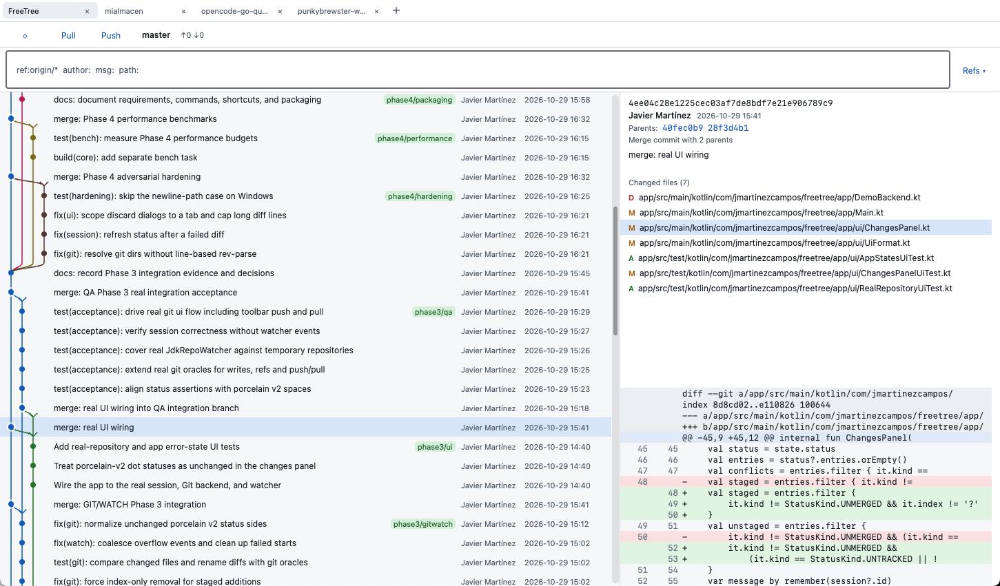

# FreeTree

FreeTree is a desktop Git client focused on making repository history easy to read and navigate.
It renders the commit graph with lanes, merge edges, and branch/tag/HEAD labels, so you can see how
work diverged and came together without dropping into the terminal. From the same window you can
inspect commits, review changed files and unified diffs, stage, discard, or commit changes, check
out branches and commits, and push or pull against the configured `origin`.



FreeTree is built with Kotlin and Compose Multiplatform Desktop. It uses the system `git` binary as
its source of truth and never writes directly into `.git`.

> **Status: alpha / work in progress.** FreeTree is usable for everyday repository browsing and
> basic staging, committing, branch operations, and push/pull, but it is still being hardened.
> Expect rough edges, incomplete workflows, and possible breaking changes. Back up important work
> and prefer a normal Git client or the command line for destructive operations.

## What this program can do

- Browse a visual commit graph with stable lanes, merge arrows, and ref chips.
- Open a commit to see its metadata, changed files, and unified diff.
- Review working-tree status and stage, unstage, discard, or commit changes.
- Push and pull against `origin` without credential prompts, setting upstream when needed.
- Filter branches with include/exclude rules for author, message, or date, and filter history by
  refs, author, message, date, or path; hide refs interactively.
- Check out branches or commits, create and switch branches, create tags, and delete branches from
  the commit context menu.
- Switch branches with a searchable picker.
- Copy diff text or all loaded diff lines.
- Customize the theme, history row layout, and panel layout; window geometry, preferences, and
  session state are restored on launch.
- Keep multiple repositories open in tabs, with only the active repository doing engine work.
- Navigate the graph and panels with the keyboard.

## Requirements

- **JDK 25** for building and running. The build uses `jvmToolchain(25)`; Gradle can provision a
  matching JDK through the foojay resolver when one is not installed locally.
- **Git 2.30 or newer** on `PATH`. FreeTree runs the system `git` binary and never writes to
  `.git` directly.
- Linux, macOS and Windows are supported.

## Modules

- `core/` — pure Kotlin/JVM. Models, Git backend, graph, query, filters, watcher, and session
  code. No Compose.
- `app/` — Compose Multiplatform Desktop application.

## Commands

```bash
# Run the app
./gradlew :app:run

# Run the test suites
./gradlew :core:test
./gradlew :app:test

# Quality gate: all tests plus compile checks (not benchmarks, not screen-dependent UI tests)
./gradlew check

# Build everything
./gradlew build
```

Run the app against a repository by passing its path:

```bash
./gradlew :app:run --args="/path/to/repo"
```

Without an argument, FreeTree restores the previous session or shows the empty state, where
**Open repository…** selects a directory.

## Keyboard shortcuts

| Keys | Action |
|---|---|
| `↑` / `↓` | Select the previous / next commit |
| `Page Up` / `Page Down` | Move by one page |
| `Home` / `End` | Select the Changes row / the oldest commit |
| `Ctrl+R` (macOS: `Cmd+R`) | Refresh the active repository |
| `Ctrl+W` (macOS: `Cmd+W`) | Close the active tab |
| `Ctrl+Tab` | Activate the next tab |
| `Ctrl+Shift+Tab` | Activate the previous tab |
| `Ctrl+O` (macOS: `Cmd+O`) | Open a repository |
| `Enter` in the query field | Apply the query |

The menu bar also exposes repository actions, recent repositories, ref visibility, window
navigation, About FreeTree, Preferences, and Messages Log.

## Packaging

A native installer can only be produced for the host operating system; `jpackage` is
host-specific. All targets are declared, but Gradle skips the ones this host cannot build.

```bash
./gradlew :app:packageDmg   # macOS: app/build/compose/binaries/main/dmg/FreeTree-1.1.0.dmg
./gradlew :app:packageDeb   # Linux: requires dpkg
./gradlew :app:packageRpm   # Linux: requires rpm-build
# Linux: app/build/compose/binaries/main/rpm/freetree-1.1.0-1.x86_64.rpm
./gradlew :app:packageMsi   # Windows: requires WiX
```

On Fedora, install the RPM tooling first:

```bash
sudo dnf install rpm-build
```

On macOS the Dmg is built and verified. `packageDeb`, `packageRpm`, and `packageMsi` are skipped on
macOS, and the reverse is true on Linux and Windows. The Dmg is not signed or notarized; Gatekeeper
may warn when it is downloaded on another machine.

## Benchmarks

Benchmarks are opt-in and are never part of `check`. Run:

```bash
./gradlew bench
```

The harness uses a seeded 50k in-memory DAG and a cached 200k-commit repository under
`build/perf-repo/`. The fixtures live in `core/src/testFixtures` (see
[docs/09-testing.md](docs/09-testing.md)).

## Large repositories

For repositories with hundreds of thousands of commits, write a commit-graph to speed up
`git log`:

```bash
git commit-graph write --reachable
```

FreeTree **never** runs this automatically; it only reads the repository. Re-run it after large
history changes if log performance degrades.

## Known limits

- No conflict resolution, hunk/line staging, rebase, cherry-pick, reset, stash, amend, or `fetch`.
- No credential management.
- No syntax highlighting, side-by-side diff, file editing, or submodule management.
- Branch filters support author, message, and date rules only; no regex, commit-body, or path
  rules.
- Multiple tabs, but only the active repository runs engine work. Inactive tabs keep their last
  immutable snapshot.
- Worktrees and submodules are treated as ordinary working trees; there is no dedicated management
  UI.
- Diffs larger than 2 MB and binary files are truncated or labelled; loading a full diff is an
  explicit action.

## License

FreeTree is free software: you can redistribute it and/or modify it under the terms of the
GNU General Public License as published by the Free Software Foundation, either version 2 of the
License, or (at your option) any later version.

FreeTree is distributed in the hope that it will be useful, but WITHOUT ANY WARRANTY; without even
the implied warranty of MERCHANTABILITY or FITNESS FOR A PARTICULAR PURPOSE. See the
[GNU General Public License](LICENSE) for more details.

SPDX-License-Identifier: GPL-2.0-or-later
